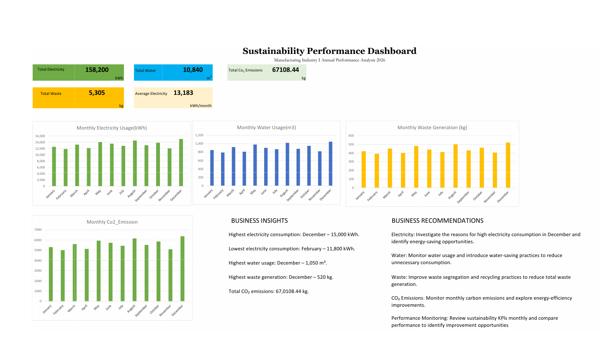

# Sustainability---Dashboard
A data analytics project to monitor energy, water, waste and environmental performance in manufacturing.
## 📊 Project Dashboard

[📥 Download Sustainability Dashboard](./Sustainability_Dashboard.xlsx)

### Project Features
- Monthly Electricity Consumption Analysis
- Water Usage Analysis
- Waste Generation Analysis
- CO₂ Emissions Calculation
- Sustainability KPIs
- Business Insights and Recommendations

### Tools Used
- Microsoft Excel
  
## 📊 Dashboard Preview

---

## 🎯 Project Overview

This project focuses on analysing sustainability performance in manufacturing operations using Microsoft Excel.

The dashboard provides a clear overview of electricity consumption, water usage, waste generation, and CO2 emissions through KPI metrics and charts.

The purpose is to support data-driven decision-making and identify opportunities for environmental improvement.

## 📈 Key Findings

Based on the sample dataset:

| KPI | Annual Result |
|---|---:|
| Total Electricity | 158,200 kWh |
| Total Water | 10,840 m³ |
| Total Waste | 5,305 kg |
| Total CO2 Emissions | 67,108.44 kg |
| Average Electricity | 13,183.33 kWh/month |

### Key Observations

- December recorded the highest electricity consumption.
- December recorded the highest water usage.
- December recorded the highest waste generation.
- February recorded the lowest electricity, water, and waste values.

## 💡 Business Recommendations

1. **Energy Efficiency:** Investigate high electricity consumption and identify energy-saving opportunities.
2. **Water Management:** Monitor monthly water usage and introduce water-saving practices.
3. **Waste Management:** Improve waste segregation and recycling practices.
4. **Carbon Reduction:** Monitor CO2 emissions and explore renewable energy opportunities.
5. **Performance Monitoring:** Review sustainability KPIs every month.

## 🛠️ Tools & Skills Demonstrated

- Microsoft Excel
- Data Analysis
- Data Visualization
- KPI Monitoring
- Sustainability Reporting
- Business Insights
- Analytical Thinking

## 📌 Project Data

This project uses a sample dataset created for learning and portfolio demonstration purposes. The figures do not represent actual company performance.

---
## 🧮 Calculation Methodology

### Electricity Consumption
Total Electricity = SUM of monthly electricity consumption.

### Water Usage
Total Water = SUM of monthly water consumption.

### Waste Generation
Total Waste = SUM of monthly waste generation.

### CO2 Emissions
CO2 Emissions = Electricity Consumption × Emission Factor

Emission Factor Used: 0.4242 kg CO2/kWh

Total CO2 Emissions = 67,108.44 kg CO2

*Note: The emission factor is an assumed reference factor for this sample project. Actual reporting should use the applicable official Sri Lankan grid emission factor for the reporting year.*

## 🚀 Future Improvements

- Create an interactive Power BI dashboard.
- Add monthly sustainability trend analysis.
- Compare actual performance against sustainability targets.
- Develop automated KPI reporting.

## 👩‍💻 Author

Tharushi Kaushalya

Aspiring Business Analyst
